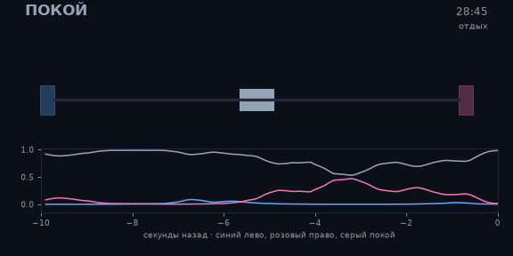

# BCI-декодер ЭЭГ

Свой проект Севы, старт 30.10.2026. Столп 2 — «Аппаратный апгрейд сознания».

## Финиш
Видео на минуту: представляешь движение левой или правой рукой — курсор или персонаж в игре едет туда же. Плюс чистый код на GitHub и короткий разбор: что пробовал, какая точность, где упёрся.
Без расписания по неделям (решено 30.10.2026): код пишется быстро. Реальные тормоза только три — понять самому, что происходит; достать железо; записать свои данные.

## Как это работает
Воображаемое движение правой рукой → ритм над левой моторной корой (C3) в полосе 8–30 Гц проседает (десинхронизация, ERD). Левой рукой — над правой (C4). Модель ловит, где просел ритм.

## Этапы
| # | Что | Результат | Статус |
|---|---|---|---|
| 1 | Окружение, MNE, MOABB; BCI Competition IV 2a: фильтр 8–30 Гц → CSP → LDA | первая модель, топокарты | ✅ 30.10.2026: S1 — 85% (2 кл.), 76% (4 кл.) |
| 2 | Все 9 человек, подбор настроек, сохранение модели | таблица точности по людям | ◐ 30.10.2026: 9 человек прогнаны (51–95%, среднее 74.5%), визуализатор готов; настройки и сохранение — впереди |
| 3 | EEGNet (braindecode), сравнение с классикой | где ML реально помогает | ✅ 07.11.2026: на одном человеке ничья (73.8 vs 74.5%); без калибровки EEGNet 78.8% vs CSP 72.9% |
| 4 | Онлайн без железа: запись идёт потоком, модель двигает объект в игре; класс «покой» | конвейер реального времени | ✅ 17.11.2026: поток через LSL (симулятор записи + BrainFlow под Ganglion), класс «покой», кубик в браузере. Поток = раздельный расчёт на 100% решений, ~1 мс на решение. 22 канала: на покое курсор едет 10% времени, в нужных пробах доезжает до своей стороны в 67%; 4 канала как у Ganglion — 6% и 45%. Без класса «покой» (только порог уверенности) — 12% и 38% |
| 5 | Своя гарнитура (или лаборатория в Риге), электроды C3/Cz/C4, свои данные, калибровка | демо с моим мозгом | ждёт железа |

Ожидания: на 2a порядка 65–75% на 4 классах, на 2 классах выше. Часть людей плохо управляет такими BCI — это тоже пишем в разбор.

## Фишка
Агент-лаборант на базе его шины агентов: сам гоняет эксперименты, перебирает настройки, ведёт журнал результатов.

## Железо
Цены и варианты — `../../self/05-work.md` (30.10.2026). До этапа 5 железо не нужно, но искать его стоит заранее: доставка и ввоз — самое долгое.

## Визуализатор
Пересчитать данные (после правок модели): `.venv/Scripts/python app_export.py`
Запустить (из `projects/bci`): `python -m http.server 8765 --bind 127.0.0.1 --directory app` → http://localhost:8765
Для 3D нужен интернет: Three.js грузится с jsdelivr.
Живой курсор: `stream.html` (данные — `.venv/Scripts/python stream_sim.py`).
Проще всего: двойной клик по `app/run.cmd` — запустит сервер и откроет курсор. Открывать html двойным кликом как файл нельзя: браузер не даст загрузить данные.

## Какую модель брать (17.11.2026)
`compare.py`, 9 человек, левая/правая рука. Внутри одного человека CSP+LDA, Riemann (MDM, TS+LDA, TS+SVM) и EEGNet — ничья: 22 канала 73.5–76.0%, 4 канала 67.9–70.1%. Без калибровки на 22 каналах EEGNet значимо лучше (78.8% против ≤72.1%), на 4 каналах преимущество пропадает (66.3–67.0%). Все быстрее 1 мс на решение. Для Ganglion выбор — Riemann TS + линейная модель на своей калибровке. Таблица — `LOG.md`, картинка — `figures/compare.png`.

## Поток в реальном времени (этап 4)


S3 из BCI IV 2a, 4 канала (C3 Cz C4 CPz, 200 Гц — как OpenBCI Ganglion), день 2, который модель не видела. 30 секунд, где точность и ложные движения близки к средним по ночи S3. S3 — лучший из 9 человек на 4 каналах, у остальных хуже (таблица в `LOG.md`, 17.11.2026). Кадры — из лога настоящего прогона (`make_gif.py`), ничего не дорисовано.

Как устроено:
- `lsl_source.py` — источник в LSL (Lab Streaming Layer, стандартная «шина» лабораторий): `replay` проигрывает запись дня 2 как прямой эфир (можно быстрее, `--speed 20`), `brainflow` — живая плата (`--board ganglion --serial-port COM3`; `--board synthetic` — проверка без платы).
- `live_decoder.py` — подписывается на поток, фильтр 8–30 Гц с памятью между кусками, окно 2 с, решение каждые 0,1 с: «влево / вправо / стоять». Модель учится на дне 1 человека (Riemann: ковариация → касательное пространство → логистическая регрессия; 3 класса — лево, право, покой). Демо — http://localhost:8766/live.html.
- `idle_eval.py` — честная проверка класса «покой» на 9 людях; `live_common.py` — общее ядро, чтобы поток и проверка считали одно и то же.

Запуск — два окна терминала (из `projects/bci`):
```
.venv/Scripts/python live_decoder.py --subject 3 --config ganglion
.venv/Scripts/python lsl_source.py replay --subject 3 --config ganglion
```
Модель обучена на чужих людях. На своём мозге с платой нужна своя калибровка — это этап 5.

## Правила проекта
- Всё по проекту — в этой папке. Свой git-репозиторий.
- Данные — в `data/`, в git не попадают.
- На GitHub — только когда есть что показать и только после его «да».
- Журнал прогресса — `LOG.md`: дата, что сделано, цифры.
